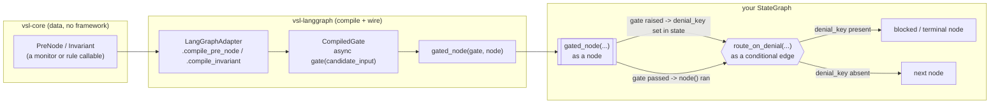

# Concepts

`vsl-langgraph` assumes the vocabulary defined by [`vsl-core`](https://github.com/4vish/VSL-Core). This page restates just enough of it to use the adapter without leaving this repo — for the complete, field-exact reference (`Fallback`, `TerminalState`, `Cluster`, `VerbaLedger`, identity/re-enablement, the Drift Class catalog), see [`vsl-core`'s README](https://github.com/4vish/VSL-Core#readme) and [`vsl-core-primitives.json`](https://github.com/4vish/VSL-Core/blob/main/docs/vsl-core-primitives.json). Nothing below is copied wholesale on purpose — if `vsl-core` changes a definition, this page should link to the new truth, not fork it.

## The gate lifecycle

`PreNode`/`Invariant` are pure data plus a callable — nothing runs yet. `LangGraphAdapter` turns one into a `CompiledGate`: a real async function. `gated_node` is what actually calls it, immediately before the node it wraps. `route_on_denial` is a plain LangGraph router reading whatever key `gated_node` wrote.

## Scope: what this adapter compiles vs. what you use directly

`vsl-core` defines more constructs than the two above. This table is the complete list — nothing is left off it — so "not mentioned" never has to mean "forgotten":

| Construct | Compiled by `LangGraphAdapter`? | How it works with `vsl-langgraph` |
|---|---|---|
| `PreNode` | **Yes** — `compile_pre_node` | Wire the result through `gated_node`. |
| `Invariant` | **Yes** — `compile_invariant` | Wire the result through `gated_node`. |
| `TerminalState`, `Fallback`, `AllowedState`, `InadmissibleState` | No | Plain data referenced by a `PreNode`/`Invariant` you already constructed. Nothing to compile — see the glossary below. |
| `VerbaLedger`, `IdentityKey`, `Instance`, `Evidence`, `GovernanceAuthority`, `HumanAuthorisedTransition`, `request_re_enablement` | No | Used directly, exactly as in any plain-Python `vsl-core` app. Full worked example (log + escalate inside a LangGraph node): [beyond-the-gate.md](beyond-the-gate.md#the-full-lifecycle-log-and-escalate). |
| `Cluster`, `ClusterKey` | No | A `Cluster`'s `invariants` are plain `Invariant` objects — compile and wire them exactly like any other. Worked example: [beyond-the-gate.md](beyond-the-gate.md#multi-agent-governance-cluster). |
| `Specification`, `Proofing`, `Binding` | No | Policy bundling/approval, sitting above whatever objects you construct — unaffected by which framework wires them. See [beyond-the-gate.md](beyond-the-gate.md#policy-as-code-specification-proofing-binding). |

## Glossary

**`PreNode`** (`vsl_core.constructs.PreNode`) — a soft, threshold-based gate. Its `monitor` is an async callable (`candidate_input -> GammaEstimate`); the compiled gate calls it and compares the result against `gamma_threshold` (default `1.1`, `vsl_core.metrics.ROBUST_GAMMA_DEFAULT_THRESHOLD`). Denies by raising `AutomationDeniedException` if `estimate.sufficient(gamma_threshold)` is `False`.

**`Invariant`** (`vsl_core.constructs.Invariant`) — a hard, non-bypassable constraint. Its `rule` is an async callable (`candidate_input -> bool`). Denies by raising `InvariantViolation` (a subclass of `AutomationDeniedException`) if `rule` returns `False`. Per `vsl-core`'s own spec: an `Invariant` violation has no `Fallback`/retry path — it's meant to go straight to a terminal state, which is why it's the primitive to reach for on irreversibility boundaries (refunds, deletes, transfers), not soft thresholds.

**`GammaEstimate`** (`vsl_core.metrics.GammaEstimate`) — what a `PreNode`'s `monitor` returns. Its `gamma_hat` field is **not a 0-1 probability** — it's compared directly against `gamma_threshold` (default `1.1`), so a monitor returning `0.95` thinking "95% confident" will always fail. See [troubleshooting.md](troubleshooting.md#f-gamma_hat-mistaken-for-a-0-1-confidence-score).

**`AssuranceBasis`** / **F1/F2** (`vsl_core.metrics.AssuranceBasis`) — required on every `PreNode`/`Invariant`. States two facts explicitly rather than letting you claim a trust level directly: **F1 (pre-commitment)** — does the check run before the side effect fires? **F2 (`F2Modification`: `FULL`/`PARTIAL`/`INDIRECT`/`NONE`)** — does the check touch the actual mechanism producing the action, or only a prompt/parameter around it? `AssuranceBasis.derived_level` computes `HIGH`/`MEDIUM`/`LOW` from those two facts — it's a read-only property, you can't just assert `HIGH`. In practice: a gate blocking a call to a hosted LLM API satisfies F1 but can only touch the prompt (not logits/weights behind the API), so `F2Modification.PARTIAL` caps it at `MEDIUM`, never `HIGH`. `AssuranceBasis.__post_init__` rejects any `f2_modification` that isn't a real `F2Modification` member (`f2_modification=None` or similar now raises `TypeError` immediately, instead of silently deriving `LOW`) — but this only guarantees F2 was a deliberate choice, not a correct one. **`AssuranceBasis` is a self-declared claim, not independently verified assurance** — nothing in `vsl-core` or `vsl-langgraph` checks that a stated `FULL` actually matches what the `monitor`/`rule` does (`LangGraphAdapter` does warn on one specific, detectable case: `FULL` claimed next to a monitor/rule that reaches a hosted API — see `adapter.py`'s `_warn_if_full_claim_reaches_hosted_api` — but that's a narrow heuristic, not general verification). Treat a derived `AssuranceLevel` as what a developer asserted, not as something proven.

**`CompiledGate`** (`vsl_core.conformance.protocol.CompiledGate`) — the shape both `compile_pre_node` and `compile_invariant` return: `async def gate(candidate_input) -> None`, raising on failure, returning normally on pass. This is the actual thing `gated_node` calls.

**`VSLAdapter`** (`vsl_core.conformance.protocol.VSLAdapter`) — the protocol `LangGraphAdapter` implements: `compile_pre_node(pre_node) -> CompiledGate`, `compile_invariant(invariant) -> CompiledGate`. Proven conformant by `vsl_core.conformance.suite.run_conformance_suite`, not just asserted — see [`tests/test_conformance.py`](../tests/test_conformance.py).

**`AutomationDeniedException`** / **`InvariantViolation`** (`vsl_core.exceptions`) — what a `CompiledGate` raises on denial. `InvariantViolation` subclasses `AutomationDeniedException`, so a generic `except AutomationDeniedException` (which is what `gated_node` uses) catches both, while code that needs to tell them apart can catch `InvariantViolation` specifically.

**`TerminalState`** (`vsl_core.constructs.TerminalState`) — a state from which no further automated transition is permitted without human authorisation (`requires_human_authorised_transition`, defaults `True`). An `Invariant`'s optional `on_violation` field names one; when set, the raised `InvariantViolation.terminal_state_name` records which one was entered. Not compiled into anything — you construct it, name it in `on_violation`, and your own code (typically the node reached via `route_on_denial`) is what actually "enters" it, usually by writing a `TERMINAL` ledger entry. Full worked example: [beyond-the-gate.md](beyond-the-gate.md#the-full-lifecycle-log-and-escalate).

**`Fallback`** (`vsl_core.constructs.Fallback`) — a `PreNode`'s retry/escalation policy: `on_failure` (default `"INCREASE_DELTA"`), `delta_factor` (default `1.5`), `max_retries` (default `3`), `on_max_retries` (default `"AUTOMATION_DENIED"`). **Not consumed by `gated_node` or by `LangGraphAdapter`'s compiled gates** — a denial raises immediately, once, with no retry loop. This isn't `vsl-langgraph` cutting a corner: `vsl-core`'s own `PlainPythonReferenceAdapter` doesn't consume `Fallback` either — nothing in `vsl-core` currently executes these fields as behavior. They're policy data a caller could read and act on manually (e.g., a node that retries with an adjusted candidate input up to `max_retries` times before letting a denial stand), but no adapter does this automatically today.

**`VerbaLedger`** (`vsl_core.ledger.VerbaLedger`) — the hash-chained, append-only audit log. Key methods: `write`/`write_monitor`/`write_verification` (append an entry), `verify_integrity()` (never raises, returns `bool`), `audit()` (5 named checks, returns a `LedgerAuditReport`), `issue_certificate()` (returns a `VerbaCertificate` only if the audit fully passes, `None` otherwise — never fabricated). Nothing in `vsl-langgraph` writes to it — see [gated_node doesn't write to the ledger either](#gated_node-doesnt-write-to-the-ledger-either) below, and the full worked example in [beyond-the-gate.md](beyond-the-gate.md#the-full-lifecycle-log-and-escalate).

**`IdentityKey`** (`vsl_core.identity.IdentityKey`) — a stable identifier scoping counters, limits, and process `Instance`s (`IdentityKey.generate(prefix="vsl")` mints one). What `VerbaLedger`'s `identity_key` argument expects, as a plain string (`str(identity_key)`).

**`Instance`** (`vsl_core.identity.Instance`) — one execution of a process, scoped by an `IdentityKey` (`Instance.new()`). Immutable — re-enablement produces a brand-new `Instance` (`generation` incremented, `predecessor_instance_id` set), never mutates the old one.

**`Evidence`** (`vsl_core.identity.Evidence`) — required for re-enablement: `root_cause_analysis` and `specification_update_proposal`, both validated non-empty at construction.

**`GovernanceAuthority`** (`vsl_core.governance.GovernanceAuthority`) — a named role/body authorised to approve exceptions and transitions (`name`, `escalation_contact`, optional `secondary_authorities`/`response_time_sla_seconds`).

**`HumanAuthorisedTransition`** (`vsl_core.governance.HumanAuthorisedTransition`) — an auditable, explicit human-approval record. Construct via `.authorise(authority, authorised_by=..., evidence=...)`, not the bare constructor.

**`request_re_enablement`** (`vsl_core.governance.request_re_enablement`) — the one sanctioned way out of a `TerminalState`: pairs a new `Instance` with the `HumanAuthorisedTransition` record that authorises it, so you can't get one without the other. (`Instance._re_enable()` exists underneath but is deliberately named with a leading underscore — not the sanctioned entry point.)

**`Cluster`** (`vsl_core.cluster.Cluster`) — a higher-order identity formed by coordinating multiple constituent `IdentityKey`s, for governance requirements that don't exist at any single constituent's level (`vsl-core`'s own motivating example is the 2010 Flash Crash: individual Gamma > 1, Cluster Gamma = 0). LangGraph is specifically a multi-agent framework, so this is the construct most worth not skipping. Its `invariants` field holds plain `Invariant` objects — compile and wire them through `LangGraphAdapter`/`gated_node` exactly like any other. `__post_init__` refuses to construct if a declared constituent isn't covered by the given `ClusterKey`. Full worked example: [beyond-the-gate.md](beyond-the-gate.md#multi-agent-governance-cluster).

**`ClusterKey`** (`vsl_core.identity.ClusterKey`) — the composite key for a `Cluster`'s constituents (`ClusterKey.from_constituents(...)` derives it deterministically from a hash of the sorted constituent values). Deliberately not a subtype of `IdentityKey`, so a cluster-level key can never be silently accepted where a single-system key is expected.

**`Specification`** (`vsl_core.governance.Specification`) — Policy-as-Code: a versioned, machine-readable bundle of `PreNode`/`Invariant`/`TerminalState` objects, requiring a named `approved_by: GovernanceAuthority` at construction and a `Binding` (which itself requires a successful `Proofing`) before `activate()` will succeed.

**`Proofing`** / **`Binding`** (`vsl_core.governance`) — `Proofing` is the result of an automated check that a claimed attribute matches an authoritative record (`verified: bool`, `verified_against: str`). `Binding` links a *verified* `Proofing` to an approved escalation path, and structurally refuses to construct from an unverified one.

**`AllowedState`** / **`InadmissibleState`** (`vsl_core.constructs`) — descriptive/classification types, not runtime-enforced. `AllowedState` documents a state that met all prerequisites (carries its own `AssuranceBasis`); `InadmissibleState` documents one that must not occur (`signature`: a free-text description of the detection pattern). Neither has a compile step — the actual enforcement is whatever `PreNode`/`Invariant` you've gated the relevant node with.

## Which gate for which LangGraph node?

Adapted from `vsl-core`'s own decision heuristic (`vsl-core-primitives.json`'s `decision_heuristic`) for a LangGraph node you're looking at:

| What the node does | Reach for | Why |
|---|---|---|
| A side effect on an external system (payment, email, DB write, another API call) | `PreNode` | Gate it before it fires, checked against a monitor's `GammaEstimate`. |
| An irreversibility boundary (refund, delete, transfer — can't be cleanly undone) | `Invariant` | Tends to be a "cannot be bypassed" case, not context-dependent. |
| A router or node consuming untrusted input (a tool's return value, retrieved content, another agent's message) | `PreNode` gating the *next* action, not the input itself | Neither `vsl-core` nor `vsl-langgraph` sanitizes input — they gate what happens after it. |
| The graph about to act outside what this run was scoped for | `Invariant` | Usually a hard "never," same as `vsl-core`'s scope-escalation case. |
| A read-only lookup node with no side effect | Neither | Over-gating adds noise without adding safety. |

## `gated_node` doesn't write to the ledger either

`vsl-core`'s README is explicit that **the ledger doesn't write itself** — `VerbaLedger` writes are never automatic, only the gate's raise/return is. The same is true here: `gated_node` calls the gate and routes on denial, and that's it. It does not call `VerbaLedger.write*` anywhere. If you want an audit trail, your own node (or a wrapper around `gated_node`) has to write it explicitly — see `vsl-core`'s [`request_re_enablement`/ledger pattern](https://github.com/4vish/VSL-Core#the-ledger-doesnt-write-itself-read-this-before-assuming-an-audit-trail-exists) for the shape, or the full worked example (real ledger writes, real `audit()`, a real issued `VerbaCertificate`) in [beyond-the-gate.md](beyond-the-gate.md#the-full-lifecycle-log-and-escalate). This is easy to assume for free and isn't — see [troubleshooting.md](troubleshooting.md) for what that assumption looks like when it bites.

## Next

- [quickstart.md](quickstart.md) — walk from `pip install` to a working chained-gate graph.
- [api-reference.md](api-reference.md) — `LangGraphAdapter`, `gated_node`, `route_on_denial` signatures.
- [beyond-the-gate.md](beyond-the-gate.md) — everything in the scope table above that isn't `PreNode`/`Invariant`, with real, run worked examples: the log+escalate lifecycle, multi-agent `Cluster`, policy bundling.
- [troubleshooting.md](troubleshooting.md) — real, reproduced failure modes.
