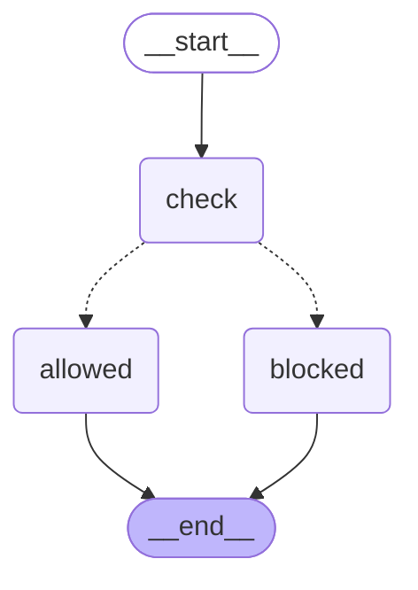
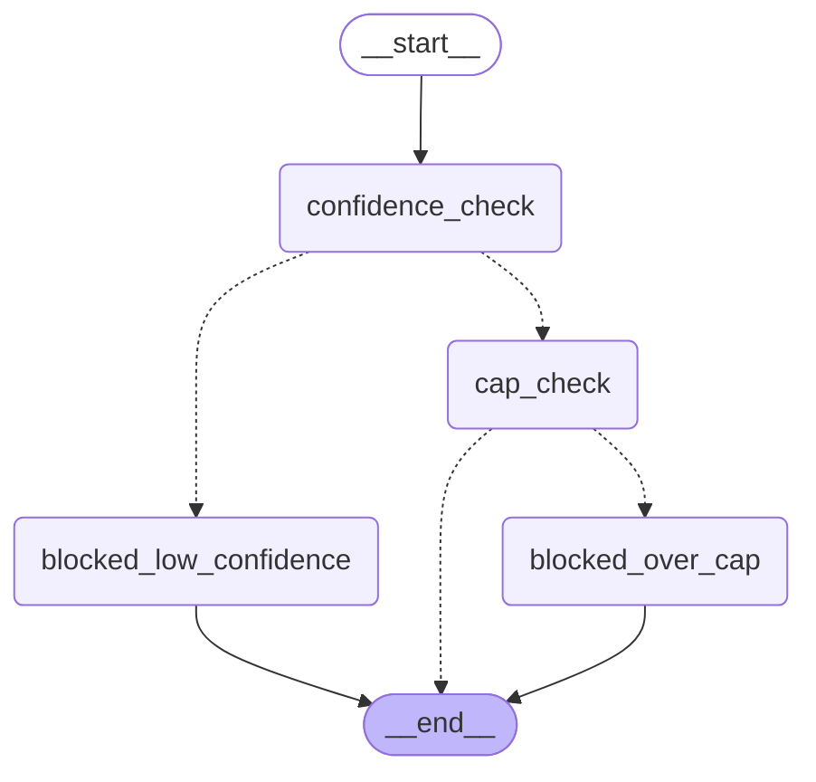
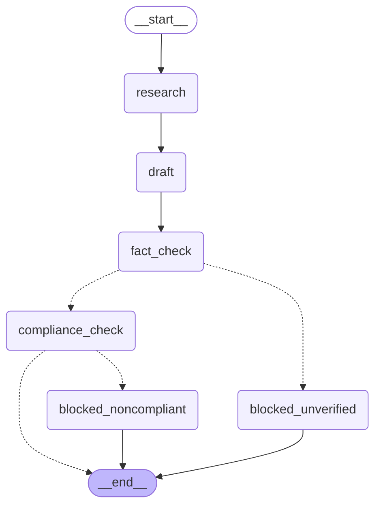
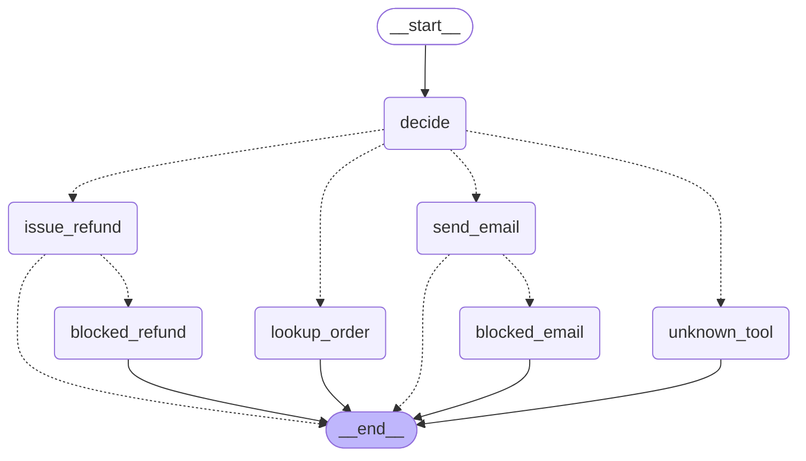
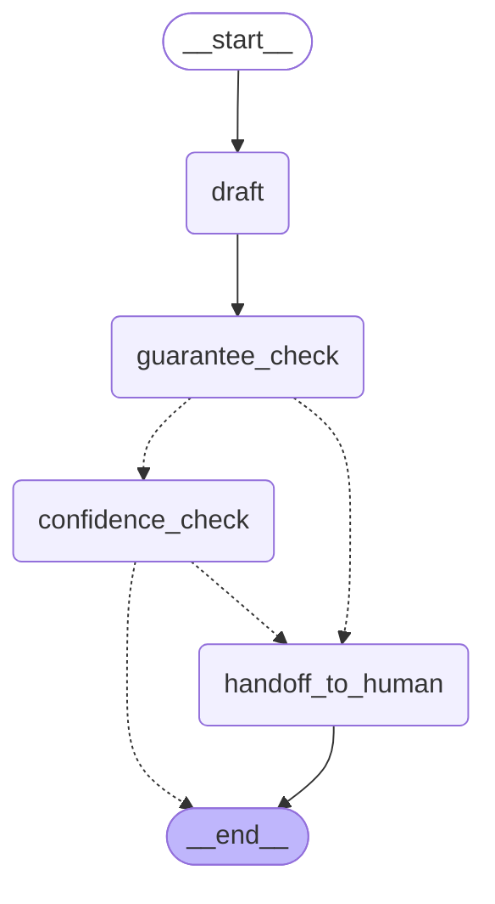

# Quickstart

Assumes the terms in [concepts.md](concepts.md) (`PreNode`, `Invariant`, `CompiledGate`, `GammaEstimate`) — read that first if any of this doesn't parse.

## Install

```
pip install git+https://github.com/supersemantics/VSL-Core.git
pip install -e .   # from a local clone of this repo
```

## Step 1: one gate

The smallest possible working graph: a `PreNode` guarding a single node, with a conditional edge routing around a denial.

```python
from typing import Any, TypedDict
from langgraph.graph import StateGraph, START, END
from vsl_core.constructs import PreNode
from vsl_core.metrics import AssuranceBasis, F2Modification, GammaEstimate
from vsl_langgraph import LangGraphAdapter, gated_node, route_on_denial

class State(TypedDict, total=False):
    gamma: float
    ran: bool
    vsl_denial: Any

async def monitor(state: State) -> GammaEstimate:
    return GammaEstimate(gamma_hat=state["gamma"])

pre_node = PreNode(
    name="my-pre-node",
    description="Requires gamma above the robust threshold before `do_the_thing` runs.",
    monitor=monitor,
    assurance_basis=AssuranceBasis(f1_pre_commitment=True, f2_modification=F2Modification.FULL),
    gamma_threshold=1.1,
)
gate = LangGraphAdapter().compile_pre_node(pre_node)

def do_the_thing(state: State) -> dict:
    return {"ran": True}

graph = StateGraph(State)
graph.add_node("check", gated_node(gate, do_the_thing))
graph.add_node("blocked", lambda state: {})
graph.add_node("allowed", lambda state: {})
graph.add_edge(START, "check")
graph.add_conditional_edges(
    "check",
    route_on_denial("blocked", "allowed"),
    {"blocked": "blocked", "allowed": "allowed"},  # optional -- see "Visualizing your own graph" below
)
graph.add_edge("blocked", END)
graph.add_edge("allowed", END)
app = graph.compile()
```



```python
>>> await app.ainvoke({"gamma": 5.0})
{'gamma': 5.0, 'ran': True}
>>> await app.ainvoke({"gamma": 0.1})
{'gamma': 0.1, 'vsl_denial': AutomationDeniedException(reason="Pre-node 'my-pre-node' insufficient Gamma", ...)}
```

`gated_node` calls `gate(...)` before `do_the_thing` — if it raises, `do_the_thing` never runs and `vsl_denial` gets set instead; `route_on_denial` reads that key to pick the next node. That ordering (gate completes, *then* the side effect) is F1 pre-commitment — see [concepts.md](concepts.md).

## Step 2: chain a soft gate and a hard gate

Real cases usually need both a `PreNode` (soft, threshold) and an `Invariant` (hard, non-bypassable) — the second one shouldn't be talkable-past by the first passing. `examples/financial-agents/purchase_approval_agent.py` is exactly this, synthetic and LLM-free:



```
python examples/financial-agents/purchase_approval_agent.py
```

Note the two `gated_node` calls each pass a distinct `denial_key` (`confidence_denial`, `cap_denial`) instead of both using the default. That's not stylistic — see [troubleshooting.md#c-reusing-the-default-denial_key-across-chained-gates](troubleshooting.md#c-reusing-the-default-denial_key-across-chained-gates) for what happens if you don't.

## Step 3: real LLM calls behind the gates

`examples/marketing/research_publish_agent.py` is the same two patterns from Step 1 and 2, except the `monitor`/`rule` callables make real calls to three different providers (Gemini, OpenAI, and three different Claude models), and the actual guarded action is a real "publish" step:



```
python examples/marketing/research_publish_agent.py
```

Runs with real API keys set (`OPENAI_API_KEY`, `GEMINI_API_KEY`, `ANTHROPIC_API_KEY`), or falls back to deterministic canned responses with zero keys set — see [examples/README.md](../examples/README.md).

## Step 4: a graph where the LLM decides which node runs next

Steps 1-3 all have a *fixed* topology — the same nodes run in the same order every time, even in Step 3 with real LLM calls. `examples/customer-support/refund_support_agent.py` is different: an LLM (`decide`) picks one of three tools from a customer's request, and a plain LangGraph conditional edge (`route_to_tool` — not `route_on_denial`) sends the run to whichever node it chose, *before* any vsl-core gate is even reached:



```
python examples/customer-support/refund_support_agent.py
```

Note two different kinds of routing in one graph: `route_to_tool` after `decide` is plain LangGraph dynamic routing on the LLM's own choice; `route_on_denial` after `issue_refund`/`send_email` is vsl-core's gate-denial routing. Don't confuse them — only the second one is a `vsl-langgraph` concept. `lookup_order` is read-only and reaches `END` ungated; `issue_refund` is gated by a non-bypassable `Invariant`; `send_email` by a soft `PreNode` — straight from `vsl-core`'s own canonical worked example in `docs/building-with-vsl-core.md`.

## Step 5: governing what the agent says, not just what it does

Every example so far gates a backend side effect (a purchase, a refund, an email, a publish). `examples/chat-conversation/chat_reply_agent.py` gates the agent's own reply text before it's sent:



```
python examples/chat-conversation/chat_reply_agent.py
```

Worth noticing: both `guarantee_check` (an `Invariant` blocking an unverified promise) and `confidence_check` (a `PreNode` gating on how confident the reply resolves the issue) route their denial to the *same* `handoff_to_human` node. `route_on_denial`'s "blocked" destination doesn't have to be a dead end — here it's a real fallback action a human actually acts on.

## Visualizing your own graph

`app.get_graph().draw_mermaid()` renders a compiled `StateGraph` as the Mermaid above, generated from the real graph object, not hand-drawn — so it can't drift from the code. Two things it needs to render conditional branches correctly (both diagrams above depend on this):

1. **A `TypedDict` state schema, not a bare `dict`.** `StateGraph(dict)` can throw `InvalidUpdateError` when `draw_mermaid()` tries to statically simulate concurrent branches.
2. **An explicit `path_map`** on `add_conditional_edges`. Without one, LangGraph can't know a router's possible return values ahead of time and silently omits the branches — you'd see only the `START` edge, nothing from the gate onward. `route_on_denial`'s two arguments already are the two possible destinations, so the map is just naming them back: `{"blocked": "blocked", "allowed": "allowed"}`.

## Next

- [api-reference.md](api-reference.md) — `LangGraphAdapter` / `gated_node` / `route_on_denial` signatures.
- [beyond-the-gate.md](beyond-the-gate.md) — everything past construct/compile/call: logging to `VerbaLedger`, escalating out of a `TerminalState`, and multi-agent `Cluster` governance, all with real worked examples.
- [dos-and-donts.md](dos-and-donts.md) — the compressed checklist version of everything on this page.
- [testing-your-gates.md](testing-your-gates.md) — how to prove your own gate wiring is correct, not just written.
- [troubleshooting.md](troubleshooting.md) — real, reproduced failure modes and fixes.
- [../examples/README.md](../examples/README.md) — the full sample-agent catalog and roadmap.
